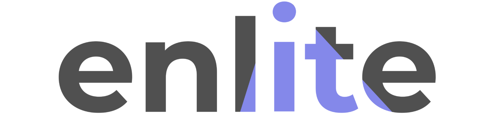

# About Roald Nefs

I'm **CTO at [Warpnet](https://warpnet.nl) and [Enlite](https://enlite.nl)**, a software engineer based in the Netherlands working across security, platform engineering, and AI. Over the past decade I've worked on software engineering, security, and platform engineering at organizations like [DUO](https://duo.nl/), [KPN](https://www.kpn.com/), [CJIB](https://www.cjib.nl/), and [DICTU](https://www.dictu.nl/).

  
    <a class="company company--warpnet" href="https://warpnet.nl" rel="noopener noreferrer" target="_blank">
      

        <svg fill="currentColor" aria-hidden="true" xmlns="http://www.w3.org/2000/svg" viewBox="0 0 148.82 148.82"><path d="M0 0v148.82h148.82V0zm52.14 42.3h1.88L66.9 16.54l5.15 25.76h-1.88l.98 4.92h1.88l1.55 7.73 1.55-7.73h-1.88l.98-4.92h1.88l5.15-25.76L95.14 42.3h-1.88l2.46 4.92h1.88l.03.05-5.88 17.65h-1.52l-1.8 5.4-5.4-5.4h1.52l-9.97-9.97-9.97 9.97h-1.52l-5.4 5.4-1.8-5.4h1.52l-5.88-17.65.03-.05h-1.88zM20.8 62.63l7.71-15.41h-1.88l2.46-4.92h1.88l5.2-10.4 3.49 10.4h-1.88l1.65 4.92h1.88l5.93 17.7h-1.52l.51 1.51L36.16 76.5h1.52L25.9 88.28 23.56 76.5h-1.52l-2.29-11.58h1.52l-.45-2.29Zm95.05 43.59-3.35 3.4h-2.7L98.41 121.2h2.7L90.2 132.28 79.12 121.2h-2.7l-4.53-4.53-4.53 4.53h2.7l-10.65 10.65-10.78-10.65h-2.7l-11.72-11.58h2.7l-3.45-3.4h-7.68l-4.97-4.92h7.68l23.05-23.05 7.68 23.05 15.37-15.37 15.37 15.37 7.68-23.05 23.05 23.05h-7.68l-4.84 4.92zm12.04-41.31h-1.52l-2.31 11.58h1.52l-2.35 11.78-11.78-11.78h-1.52l-9.84-9.84.57-1.74h1.52l5.79-17.7h-1.88l1.61-4.92h1.88l3.4-10.38 5.19 10.38h-1.88l2.46 4.92h1.88l7.72 15.44-.45 2.26Z" data-name="Layer 1" style="fill:#fff"/></svg>

      

      <h3 class="company-name">Warpnet</h3>
      
Securing technology

      
We help organizations build and secure systems, from code and cloud infrastructure to the hardware and protocols behind it. Security research, pentesting, and platform engineering, all in one team.

      warpnet.nl &rarr;
    </a>
  
    <a class="company company--enlite" href="https://enlite.nl" rel="noopener noreferrer" target="_blank">
      

        
      

      <h3 class="company-name">Enlite</h3>
      
Secure &amp; effective software development

      
We build software that is effective and secure, and that fits the way each organization works. From custom web applications to products like Secure Dropzone, Logspect, and Datamasker.

      enlite.nl &rarr;
    </a>
  

## Community

I co-organize [BSides Groningen](https://bsidesgrunn.org/), [BSides Amsterdam](https://www.bsidesams.org/), and [Cloud Native Groningen](https://cloudnativegroningen.nl/): grassroots events for the curious, the technical, and the occasionally reckless. I also run [hands-on workshops](/training/) on automotive security and hardware hacking, and operate a Car Hacking Village at conferences across Europe.

## Open source

Most of my code lives on [GitHub](https://github.com/roaldnefs). I've contributed to projects like [SaltStack](https://github.com/saltstack/salt/pulls?q=is%3Apr+author%3Aroaldnefs), [Prometheus](https://github.com/prometheus/client_golang/pulls?q=is%3Apr+author%3Aroaldnefs), and [rfcat](https://github.com/atlas0fd00m/rfcat/pulls?q=is%3Apr+author%3Aroaldnefs), and maintain a few of my own. One of those is [WebUSB CAN](https://github.com/roaldnefs/webusb-can), the browser-based CAN console I use in my automotive workshops.

## Off the keyboard

Outside of work, automotive security and hardware hacking are the rabbit holes I keep ending up in. The [workshops](/training/) and the [Car Hacking Village](https://roaldnefs.github.io/car-hacking-village/) all come from that hobby. I also tinker with electronics, RF, and lockpicking; the [Tools](/tools/) page lists what's currently on the bench.

## Get in touch

- Email: [info@roaldnefs.com](mailto:info@roaldnefs.com)
- LinkedIn: [linkedin.com/in/roaldnefs](https://www.linkedin.com/in/roaldnefs/), with full work history, education, and certifications.
- Mastodon: [@roald@infosec.exchange](https://infosec.exchange/@roald)
- GitHub: [github.com/roaldnefs](https://github.com/roaldnefs)
