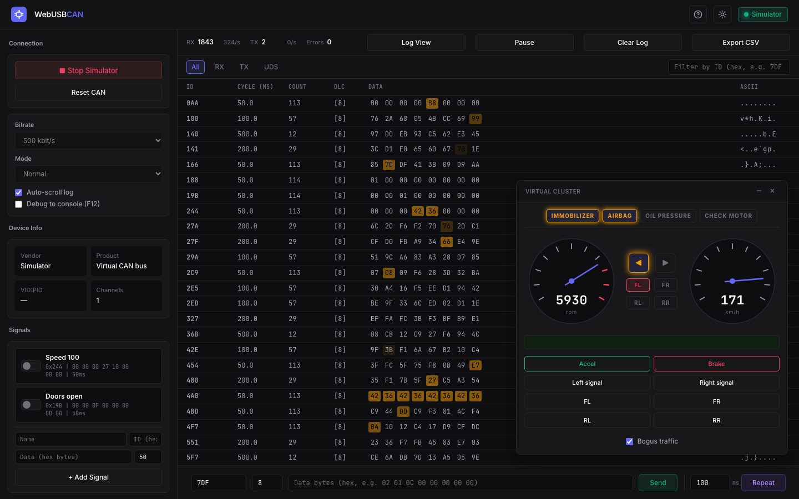

## Introduction
Before you can read a single frame from a CAN bus, you need a working setup. On Linux that means SocketCAN and can-utils[^can-utils]. On Windows and macOS it usually means a driver, a vendor tool, or a Linux VM with USB passthrough. None of that is hard, but in a workshop it is time spent on laptops and not on the car.

[WebUSB CAN](https://roaldnefs.github.io/webusb-can/) is my attempt to skip that step. It is a CAN bus console that runs in a browser tab. You plug in a USB-to-CAN adapter, open the page in Chrome or Edge, pick a bitrate and click **Connect**. There is nothing to install, and if you have no adapter the page comes with a simulated car.

The source is on GitHub at [roaldnefs/webusb-can](https://github.com/roaldnefs/webusb-can) under the MIT license.



## What you need
- **Chrome or Edge.** Firefox and Safari do not implement WebUSB[^webusb].
- **An adapter running gs_usb compatible firmware**, such as candleLight[^candlelight]. That covers the candleLight, the CANable and the CANable 2.0.

Adapters running slcan firmware are not supported. Neither are PCAN-USB, Kvaser, Vector or other adapters with a proprietary protocol.

The easiest way to use it is the hosted version at [roaldnefs.github.io/webusb-can](https://roaldnefs.github.io/webusb-can/). To run it yourself, clone the repository and serve it from any static web server:

```bash
git clone https://github.com/roaldnefs/webusb-can.git
cd webusb-can
python3 -m http.server 8000
```

Then open `http://localhost:8000`.

## What it does
The page is built around the workflow of reverse engineering a bus: watch the traffic, find the frame that matters, send it yourself.

- **Log view.** Every frame in the order it arrives, with filters on direction and CAN ID. The log can be paused and exported as CSV.
- **Sniff view.** One row per CAN ID, where a byte that changes flashes amber. If you know `cansniffer`, this is the same idea. Press a button in the car and watch for the flash.
- **Send and repeat.** Type an ID and data bytes in hex and send the frame once or on an interval.
- **Signals.** Named periodic senders that you switch on and off. They survive a reload.
- **Fuzzer.** Modelled on `cangen`, with random, incrementing or fixed values for the ID, length and data.
- **UDS.** A request panel for diagnostics. It handles multi-frame messages over ISO-TP, shows negative response codes by name, and can send Tester Present to keep a session open.

The adapter can run in normal, loopback or listen-only mode. Listen-only is the one you want when you connect to a bus you do not know yet.

## How it works
WebUSB gives a web page raw access to a USB device, after the user has picked that device in a browser dialog. The page then has to speak the protocol of the device itself.

For these adapters that is gs_usb, named after the Linux kernel driver that implements the host side[^gs-usb]. It is a small protocol. A few control requests set the bitrate and the mode, and after that every CAN frame is a 20-byte struct sent over USB. The page implements this in a few hundred lines of JavaScript, without a build step or a framework.

## No adapter? Use the simulator
**Start Simulator** replaces the USB device with a virtual bus inside the page. A floating instrument cluster shows a speedometer, a tachometer, turn signals, door indicators and warning lamps, with buttons for the accelerator, the brake, the signals and the doors.

The cluster reacts to any frame on that bus, whether it comes from its own buttons, the send bar or the fuzzer. The log, the sniffer and the UDS panel behave the same as with a real adapter.

The CAN IDs for speed, turn signals and doors match ICSim[^icsim], the instrument cluster simulator that many car hacking workshops are built on. Exercises written for ICSim carry over, without Linux.

A **Bogus traffic** option adds random IDs, so finding the frame you are after takes some work. The cluster also has a few challenges and easter eggs built in. I will leave those for you to find.

## Scripting from the console
Everything the buttons do is also available from the DevTools console as `window.api`. Start the simulator and print the speed that the cluster broadcasts:

```js
api.simulator.start();
api.simulator.accel(true);

api.onFrame(0x244, data => {
  console.log(((data[3] << 8) | data[4]) / 100, 'km/h');
});
```

Sending works the same way. This opens all four doors on the cluster for a second:

```js
const r = api.sendRepeat({
  id: 0x19B,
  data: [0, 0, 0x0F],
  intervalMs: 50,
});
setTimeout(() => r.stop(), 1000);
```

The same calls work against a real adapter after `await api.connect()`. The full reference is in the [README](https://github.com/roaldnefs/webusb-can#console-api).

## Limitations
- **gs_usb only.** No slcan, and no adapters with a proprietary protocol.
- **Classic CAN only.** There is no CAN FD.
- **Chromium only.** In a browser without WebUSB, only the simulator is of use.
- **A browser tab is not a real-time system.** Periodic senders are fine for moving a needle on a cluster. They are not a replacement for a tool that needs precise timing.

## Conclusion
WebUSB CAN does not replace can-utils or SavvyCAN. It is for the moment when you want to look at a bus now, on whatever laptop is in front of you, or when you want a room full of people sniffing and sending frames in the first five minutes.

If you want a real car to point it at, see my post on [building a car hacking test bench](). If you try the tool and something breaks, please open an issue on [GitHub](https://github.com/roaldnefs/webusb-can/issues).

[^can-utils]: can-utils, the Linux-CAN / SocketCAN user space applications, including `candump`, `cansniffer` and `cangen`: https://github.com/linux-can/can-utils.
[^webusb]: MDN, WebUSB API: https://developer.mozilla.org/en-US/docs/Web/API/WebUSB_API.
[^candlelight]: candleLight firmware: https://github.com/candle-usb/candleLight_fw.
[^gs-usb]: The gs_usb driver in the Linux kernel: https://github.com/torvalds/linux/blob/master/drivers/net/can/usb/gs_usb.c.
[^icsim]: ICSim, the Instrument Cluster Simulator for SocketCAN by Craig Smith: https://github.com/zombieCraig/ICSim.
