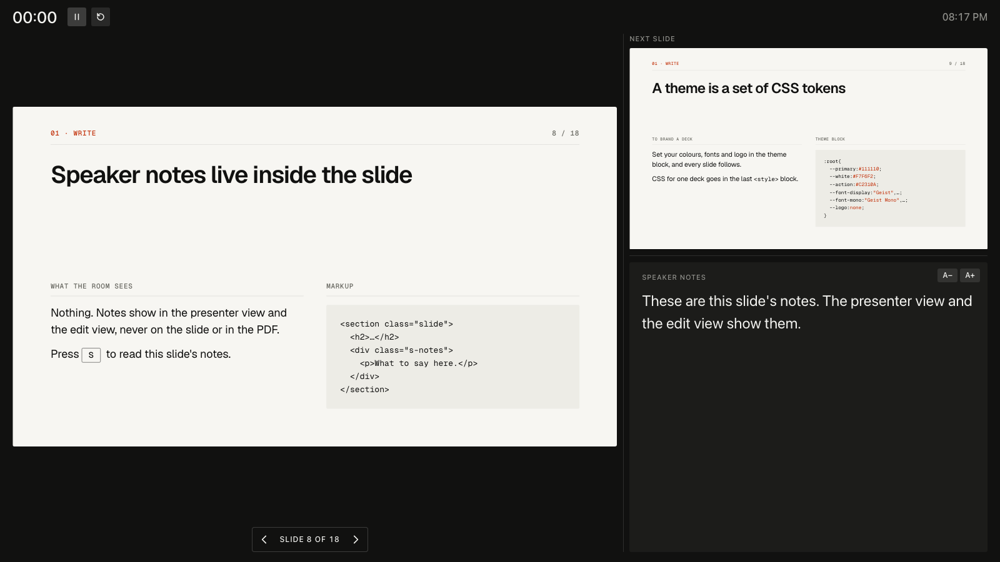
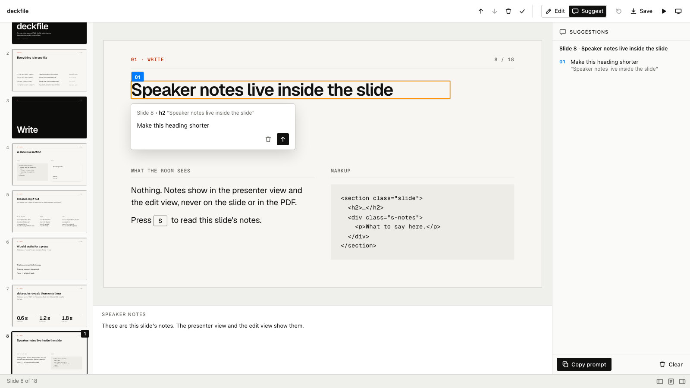

## Introduction
When I prepare a talk, I want to spend my time on the content. In practice a lot of it goes into the slides themselves: nudging text boxes, fixing a template, lining things up. That is time spent on PowerPoint and not on the talk.

As an engineer I also want the things I am used to. A deck should be a text file that lives in git and shows up in a diff. It should work on a laptop without Wi-Fi. And it should not need a toolchain that has to be installed again a year later, when I want to give the talk a second time.

[deckfile](https://github.com/roaldnefs/deckfile) is what I built for that. A presentation is one `index.html` that holds the slides, the engine and the theme. There is no build step, no bundler and no dependencies. You can click through the [live demo](https://roaldnefs.github.io/deckfile/), which is itself a deck about deckfile. The source is on GitHub under the MIT license.

## A deck is one file
To start, copy [`template.html`](https://github.com/roaldnefs/deckfile/blob/main/template.html) from the repository to `my-talk/index.html` and open it in a browser. Press `→` to step through it. The template explains deckfile and shows every slide type of the default theme, so you start by replacing its slides with your own.

The engine is about 1,700 lines of plain JavaScript and 50 lines of CSS, inlined in the file. The template is around 130 KB in total. Because everything is in the file, the deck opens from disk with a double-click and works the same from any static host. The one thing it fetches is a web font, and without a network the text falls back to a system font.

## Writing a slide
The engine needs very little markup. This is a complete slide with two build steps and speaker notes:

```html
<div id="stage">
  <section class="slide">
    <h2>One idea per slide</h2>
    <ul>
      <li class="build">Revealed on the first →</li>
      <li class="build">and this one on the second</li>
    </ul>
    <div class="s-notes"><p>What to say here.</p></div>
  </section>
</div>
```

Every `<section class="slide">` is a slide, in the order of the document. An element with `class="build"` is revealed one key press at a time. A `<div class="s-notes">` holds the speaker notes.

The stage is a fixed canvas of 1920 by 1080 pixels, scaled to the screen with a single CSS transform. You position everything in canvas pixels and it looks the same on a laptop and on a projector.

The rest comes from the theme: title slides, dividers, dark slides, rows of big numbers, two columns and a terminal panel for code. To brand a deck you change a handful of CSS variables for the colours, the fonts and the logo. The theme sits in its own `<style>` block, separate from the engine, so you can change it as much as you like.

## Presenting
Press `S` and a second window opens with the presenter view. It shows the current slide, what the next press brings, your notes, a clock and a timer. Drag the deck window to the projector, press `F` for fullscreen and keep the presenter view on the laptop. The arrow keys, Space or a clicker work from either window.



The deck, the presenter view and its slide previews are all the same file, opened with a different query string. The two windows stay in step with `postMessage`[^postmessage], which also works between pages opened from `file://`. So the presenter view needs no server either.

A few details are there for the moment something goes wrong on stage:

- **A reload keeps your place.** The current slide is stored in `sessionStorage`, so a reload during a talk lands on the same slide.
- **The screen stays awake.** The deck asks the browser for a screen wake lock[^wakelock], so the laptop does not dim halfway through.
- **A PDF is one key away.** Press `P` to print, with one page per slide and all builds shown.

## Editing in the browser
You can write a deck in your editor, but small changes are faster on the slide itself. Press `E` for the edit view. Double-click a text to type in it, select an element to move, duplicate or delete it, and add or reorder slides from the thumbnails. **Save** writes the result back to the HTML file[^savepicker].



The edit view has a second mode, **Suggest**. It does not change the deck. You click an element, pin a spot or drag a box around an area, and type what should change. **Copy prompt** then puts every suggestion on the clipboard as one Markdown prompt, each with its slide, its position and a selector for the element. You paste that into a coding agent and it knows what you were pointing at.

That makes a review one pass: go through the slides, leave a note where something is off, and hand the whole list over in one go.

## Letting an agent write the deck
A deck that is plain HTML in one file is easy for a coding agent to write. The repository is also a Claude Code plugin with a `deck` skill:

```text
/plugin marketplace add roaldnefs/deckfile
/plugin install deckfile@deckfile
```

The skill writes a deck from a brief. It asks what the talk is about and who it is for, proposes an outline, and only writes slides once you agree with that outline. After the slides come the speaker notes and a self-check.

This is where the time goes back to the content. You think about the story, the order and what each slide has to say. The agent turns that into markup, and you correct it in the edit view.

## Keeping the engine up to date
Inlining the engine means every deck carries its own copy. When a new version comes out, one command replaces it:

```bash
npx github:roaldnefs/deckfile update my-talk/index.html
```

This only touches what is between the engine tags. The theme, the slides and your own scripts stay as they are. With `update --check` it writes nothing and exits with 1 when a deck is out of date, which is useful in CI.

## Limitations
- **The presenter view needs a second window.** You have to allow pop-ups for the page.
- **The first save rewrites some markup.** The edit view saves the page the way the browser read it, so self-closed SVG tags and table markup can change once. Later saves change only what you changed.
- **Photos live beside the file.** A deck with photos travels as a folder, not as a single file.
- **No syntax highlighting.** Code goes in a terminal panel, and you colour the parts that matter by hand.
- **No PowerPoint or Google Slides.** The output is HTML and, through print, PDF.

## Conclusion
deckfile is for people who would rather write a talk than draw one. If you are comfortable with a bit of HTML, or with letting an agent write it for you, you get a deck that lives in git, opens anywhere and still works in a few years.

If you let a coding agent build your slides, it is worth knowing what else that agent can reach. I wrote about that in [Your Coding Agent Runs as You](). If you try deckfile and something breaks, please open an issue on [GitHub](https://github.com/roaldnefs/deckfile/issues).

[^postmessage]: MDN, Window: postMessage() method: https://developer.mozilla.org/en-US/docs/Web/API/Window/postMessage.
[^wakelock]: MDN, Screen Wake Lock API: https://developer.mozilla.org/en-US/docs/Web/API/Screen_Wake_Lock_API.
[^savepicker]: In Chromium the edit view saves to a file you choose, with `showSaveFilePicker()`. In other browsers the deck is saved as a download. MDN: https://developer.mozilla.org/en-US/docs/Web/API/Window/showSaveFilePicker.
