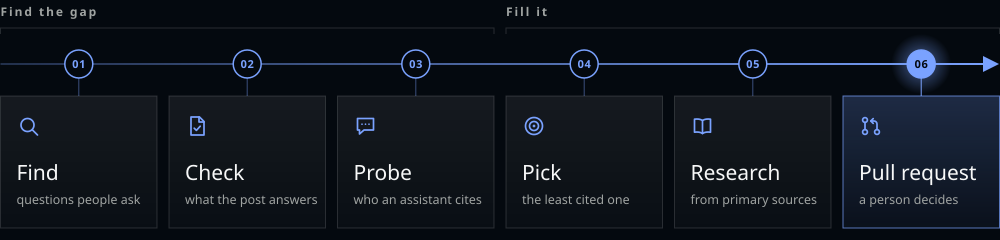

# Does an FAQ Help AI Assistants Find Your Blog Post?

> What generative engine optimization is, what the research says works, and when an FAQ on a blog post helps an AI assistant find the answer.

By Roald Nefs, November 14, 2026. Source: https://roaldnefs.com/posts/2026/11/does-an-faq-help-ai-assistants-find-your-blog-post/

## Introduction
At aiGrunn 2026 I saw the talk ["SEO first, then everything else: how EasyToys built its own AI automation tool"](https://app.aigrunn.org/session/a87da0b7-3abf-5561-9d71-cf151fa1add7) by Patrique Benes. His team built an in-house app that upgrades their existing blog posts with headings, links and FAQs. An editor always decides what goes live.

I liked the idea and wanted to try it on this blog. But I don't really care about my position in Google. What I'm curious about is the assistants: ChatGPT, Claude and the like, answering a question for someone who never opens my post. Does adding an FAQ help there? So I read up on it and built a small workflow. This post is the write-up.

Spoiler: the FAQ markup everybody recommends doesn't seem to do anything. The text itself might, as long as it answers something the post doesn't answer yet.

## What GEO is
The thing I was looking for has a name: generative engine optimization, or GEO. The term comes from a paper by researchers from Princeton University and IIT Delhi, published at KDD 2024[^geo-paper]. They took 10,000 queries, rewrote pages in nine different ways and measured how much of the generated answer came from the rewritten page.

A few results stood out to me:

- Adding citations, quotations and statistics worked best: roughly 30 to 40% better on their main visibility metric.
- Keyword stuffing did worse than doing nothing.
- Lower-ranked pages gained the most. For a page in fifth place, citing sources more than doubled its visibility.
- It differs per domain.

Don't read too much into the numbers. They measured their own generative engine plus a small sample on Perplexity, with the models of 2023 and 2024. What I take from it is that the content of a page matters to these systems. It's not a recipe.

Google, by the way, says GEO isn't a thing of its own. According to its documentation you don't need anything extra to show up in AI Overviews or AI Mode: the page has to be indexed and eligible for a snippet, same as for normal search[^google-ai].

## How an assistant ends up on your page
That same Google page mentions something called query fan-out. The assistant doesn't run the search you typed. It fires off several related searches on subtopics and builds its answer from whatever comes back[^google-ai].

I hadn't thought about it that way before. My post on sandboxing coding agents isn't only competing for "how do I sandbox a coding agent". It can also be the source for one small sub-question, but only if it actually answers that sub-question. If it almost answers it, some other page gets picked.

## Does an FAQ help?
I expected the answer to be yes. It turned out to be more complicated.

Let's start with the markup. An FAQ on a web page usually comes with `FAQPage` structured data, and plenty of articles claim that's what gets you cited. I couldn't find anything to back that up:

- Google says there's no special structured data to add for its AI features, only that structured data should match the visible text[^google-ai].
- Google stopped showing FAQ rich results on 7 May 2026[^google-faq], so the markup doesn't earn you anything in normal search anymore either.
- Ahrefs followed 1,885 pages that added structured data and compared them with matched pages that didn't. Citations in Google's AI Mode and in ChatGPT didn't change measurably, and in AI Overviews they went down by 4.6%[^ahrefs]. They pooled all schema types and only looked at pages that were already cited a lot, so it's not the final word. It's the only controlled test I found though, and it doesn't look good for the markup.

The text is a different story, but here I'm guessing. I didn't find a controlled study showing that an FAQ section gets a page cited more. My reasoning is this: the GEO paper says content matters, and fan-out means a page gets picked for a sub-question. A short answer to a real question, written the way someone would ask it, is exactly that kind of content.

So this is the rule I'm going with:

<aside class="callout callout-info">
  <span class="callout-prefix">info:</span>
  <div class="callout-body">An FAQ is only worth adding if it answers a question the post does <strong>not</strong> answer yet. Rewriting the post as questions and answers adds nothing a model couldn&rsquo;t already read.</div>
</aside>


On this blog an FAQ is a short list of questions and answers in the front matter of a post. It shows up as a section at the end of the post and in the Markdown version. It also gets the `FAQPage` markup, since that was only one template. I don't expect anything from it. The rest was already in place: AI crawlers are allowed in `robots.txt`, every page has a Markdown version and there's an `llms.txt` listing them. No idea if those last two do anything.

## Finding the question a post does not answer
Writing an answer is easy. Knowing which question to answer isn't. I have no idea what people wonder about after reading a post I wrote in 2019. So I built a workflow in n8n to find out.



For every post it looks for a question that people ask, that the post doesn't answer, and that assistants don't cite this site for.

It starts by letting Claude search the web for follow-up questions on the post's topic. Claude also gets the queries the post was shown for in Google Search Console over the last 90 days. A second request then compares each candidate with the full text of the post and throws out everything that's already answered.

What's left gets probed. Each question is rewritten first so it makes sense without the post: "Does this also work for Claude Desktop?" means nothing if you haven't read it. Then it's sent to the Claude API with web search on, three times, and the workflow checks which pages the answer cites.

The question this site is cited for the least wins. If the site is cited every time there's nothing to fix, and the workflow skips the post.

For the winning question Claude researches an answer from primary sources and writes two to four sentences. That goes into the FAQ in the post's front matter. The rest of the file isn't touched. Then the workflow opens a pull request with the question, the proposed answer and a link to the post. It never merges anything. That's the part I took straight from the talk: a person decides what goes live. When I close a pull request without merging, the question won't be proposed again.

It runs once a week and does two posts per run.

### The API calls
There's no magic in it, just HTTP requests. In the order they happen:

**Once per run**

- List the posts: `GET /repos/{owner}/{repo}/contents/content/posts` on GitHub.
- List earlier proposals: `GET /repos/{owner}/{repo}/pulls?state=all` on GitHub.
- Find the URL of each post: `GET /llms.txt` on this site.

**For each post, to gather input**

- Read the post: `GET /repos/{owner}/{repo}/contents/{path}` on GitHub.
- Get its search queries: `POST /webmasters/v3/sites/{property}/searchAnalytics/query` on Search Console.

**For each post, to Claude**

All five are `POST /v1/messages`.

1. Find questions. With web search, once.
2. Check them against the post. JSON output, once.
3. Probe. With web search, three times per question, for up to three questions.
4. Research the answer. With web search, once.
5. Write the answer. JSON output, once.

**For each proposal, on GitHub**

- Create the branch: `GET /git/ref/heads/main`, then `POST /git/refs`.
- Commit the FAQ item: `PUT /repos/{owner}/{repo}/contents/{path}`.
- Open the pull request: `POST /repos/{owner}/{repo}/pulls`.

That's up to 13 requests to Claude for a post without an FAQ. A post that already has FAQ items gets a few more, because those questions are probed again to see if the site is cited for them now.

Steps 2 and 5 don't search. I split searching and structuring on purpose: one request reads the web and writes notes, the next one turns those notes into data.

### The prompts
Below are the full prompts for the five requests to Claude. The parts in double braces are filled in by the workflow.

**1. Find questions**

```text
I maintain a personal technical blog. Below is one post. I want to add a short FAQ
item to it that answers a question readers have which the post does NOT already
answer.

Search the web to find out what people actually ask about this post's topic:
follow-up questions, adjacent tools, platforms and versions ("does this also work
for X"), recent changes since the post was written, common points of confusion. Then
list up to 8 candidate questions, most asked first. For each one, add one line on
why you think people ask it and what you found.

Leave out questions the post clearly answers, questions already in its FAQ, and
questions I rejected before.

Post title: {{ title }}
Post URL: {{ url }}

Questions already in the FAQ:
{{ existing_faq }}

Questions rejected before:
{{ rejected_questions }}

Google Search Console queries this post was shown for in the last 90 days (query,
impressions, average position):
{{ search_console_queries }}

<post>
{{ post }}
</post>
```

**2. Check them against the post**

The output is JSON with the fields named in the prompt.

```text
Below are a blog post, research notes with candidate FAQ questions for it, and its
Google Search Console queries.

Return the candidates as JSON, most asked first, at most 8. For each candidate:
- question: as it would appear in the post's FAQ, where "this" may refer to the
  post's subject.
- standalone_question: the same question as someone would type it into an AI
  assistant without having seen the post. Name the subject explicitly.
- gsc_query: the Search Console query it corresponds to, copied exactly, or an empty
  string.
- answered_in_post: true if a reader could answer it from the post alone, also when
  the answer is spread over several sections. Be strict: when in doubt it is
  answered.
- reason: one sentence for that verdict.

Add a Search Console query as a candidate when it is phrased as a question and is
not in the notes yet.

Also return every question already in the FAQ under "existing", with a
standalone_question for it.

Questions already in the FAQ:
{{ existing_faq }}

Search Console queries:
{{ search_console_queries }}

<notes>
{{ notes_from_step_1 }}
</notes>

<post title="{{ title }}">
{{ post }}
</post>
```

**3. Probe**

That's the whole prompt. No instructions around it, because that's how someone would ask.

```text
{{ standalone_question }}
```

**4. Research the answer**

```text
Research the answer to one reader question for the FAQ of the blog post below. The
post does not answer it.

Question: {{ question }}
Asked on its own it reads: {{ standalone_question }}

Search the web and work from primary sources: official documentation, release notes,
specifications, the vendor's or project's own pages. Prefer current pages over old
write-ups, and note the date of what you rely on. Do not rely on the blog post's own
site.

Then write up what you found: the answer, which source backs each claim, where
sources disagree or say nothing, and anything you could not confirm. Do not fill
gaps with what seems likely.

<post title="{{ title }}">
{{ post }}
</post>
```

**5. Write the answer**

The output is JSON again: `publishable`, `reason`, `answer`, `sources` and `unconfirmed`.

```text
Write one FAQ answer for a blog post from the research below.

Question: {{ question }}

Rules for the answer:
- 2 to 4 sentences of plain text. Inline Markdown code and links are allowed,
  nothing else.
- Start with the direct answer. It must make sense to someone who has not read the
  post.
- Only state what the research backs with a source. No guesses, no marketing, no
  advice beyond the question.
- Match the post's voice: plain, direct, short sentences.

sources: every source the answer relies on, with the claim it supports. Use only
URLs from the list below, copied exactly.
unconfirmed: what the research could not confirm or where sources disagree, one item
each. Empty if nothing.
publishable: false if the research does not give a sourced answer to the question,
if the sources conflict on the main point, or if the research did not finish.
Explain in reason.

URLs seen during the research:
{{ urls_seen_in_step_4 }}

<research finished="{{ research_finished }}">
{{ research_from_step_4 }}
</research>

<post title="{{ title }}">
{{ post }}
</post>
```

The most important line in there is "when in doubt it is answered". It's what stops the workflow from rewriting the post as an FAQ.

## The first run
The first run picked two old posts and opened two pull requests.

The first one I merged. It's on [Software Defined Radio on Linux](/posts/2019/01/software-defined-radio-on-linux/#faq):

> **rtl_test says `usb_claim_interface error -6`. What's wrong?**
>
> It means the dongle is busy: libusb error -6 is `LIBUSB_ERROR_BUSY`, which you get when another program or driver has already claimed the USB interface. Usually that's the Linux DVB-T TV driver `dvb_usb_rtl28xxu`, which grabs the stick by default. Sometimes it's a second copy of an rtl-sdr program, such as rtl_test or rtl_fm, that's still running. Close the other program, or unload the driver with `sudo rmmod dvb_usb_rtl28xxu`, and make sure your blacklist file in `/etc/modprobe.d/` ends in `.conf` and that you rebooted after creating it.

You can run into this error when following that post, and the post doesn't mention it anywhere. I wouldn't have come up with that question myself.

The second one I closed. It read fine and it had links, but it presented something as a fact that its own sources didn't support. One of them was a bug report that has since been closed as no longer reproducible. Funny enough, the model had listed that exact point as unconfirmed in its notes and then wrote it down as a fact anyway.

So treat the research as a draft. A wrong answer in an FAQ is worse than no FAQ at all, both for the reader and for the next model that picks it up. I check every answer against its sources before merging.

## What I don't know yet
Quite a lot, actually.

I don't know if it works. I have no evidence yet that an FAQ item changes how often this site gets cited, and as far as I can tell nobody else has it either.

I also don't fully trust my own probe. It measures one assistant, through the API, three times per question. That's a rough signal at best and it says nothing about ChatGPT, Perplexity or Google.
And Search Console shows what people type into Google, not what they ask an assistant. For the smaller posts there may simply be nothing in there.

Next up: add a second assistant to the probe and ask the same questions again in a few months for the posts that got an item. Then I'll know if any of this actually works.

[^geo-paper]: Pranjal Aggarwal, Vishvak Murahari, Tanmay Rajpurohit, Ashwin Kalyan, Karthik Narasimhan and Ameet Deshpande, "GEO: Generative Engine Optimization", KDD 2024: https://arxiv.org/abs/2311.09735.
[^google-ai]: Google Search Central, "AI features and your website": https://developers.google.com/search/docs/appearance/ai-features.
[^google-faq]: Google Search Central, FAQ structured data documentation, deprecation notice of May 2026: https://developers.google.com/search/docs/appearance/structured-data/faqpage.
[^ahrefs]: Louise Linehan, Ahrefs, study of schema markup and AI citations, 11 May 2026: https://ahrefs.com/blog/schema-ai-citations/.
